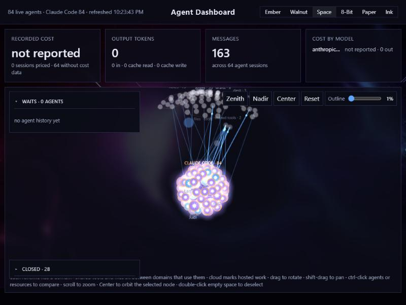

# Agent Dashboard

A local web dashboard for the coding agents running on your machine. It reads the session transcripts
that Claude Code, Codex, Pi, Google Antigravity and the DeepSeek Harness already write to disk, and draws them as a rotatable 3D graph: each
agent is a node, linked to the files, web tools, MCP servers and other agents it touches. Around the
graph it shows live usage and cost, which agents are waiting on you, and a terminal view of any
background job.



- **Read-only and local.** The server binds to `127.0.0.1`, only reads files, and sends nothing
  anywhere. The page loads xterm.js, marked, DOMPurify and Google Fonts from public CDNs.
- **No dependencies.** The server is plain Python standard library.
- **Six themes:** Ember, Walnut, Space, 8-Bit, Paper (black on white) and Ink (white on charcoal).
- **Grouped resources.** Files are grouped by folder and tools by family, each group named on the
  graph. Click a group's name to fold it into one node with a count, and click again to spread it out.
- **Two strata.** Agents sit inside a sphere whose surface holds the files and tools they use. Every
  `.md` file sits one stratum out, on a larger concentric sphere, in the same spot of its folder's
  patch. Skills live there too, as squares: a skill's `SKILL.md`, anything under `skills/<name>/`, a
  `MINISKILL.md`, and a `Skill` tool call are all one node.
- **Ship events.** When an agent's `git push` or `gh pr create` succeeds, a beam of light shoots out of
  the agent and out of its repo's folder on the graph. A Ships window lists the newest commits, pushes
  and pull requests (failed ones greyed out) with a link to each GitHub PR; click a row to replay its beam.
- **Jev circuit.** When an agent asks [Jev](#jev-circuit) for a decision, a packet runs from the agent to
  the Jev node and back, the node scans while Jev decides, and a marker at the agent says what came back.

## Filters and layouts

A bar above the graph decides what it shows. Your choices are kept in this browser (`localStorage`).

- **Agents.** One chip per runtime on the graph: Claude, GPT (Codex and OpenAI), Pi, Google
  (Antigravity) and DeepSeek (DeepSeek Harness), each with its count. Click a chip to hide or show that runtime's agents. The **Model**
  menu lists the models in use, grouped by runtime with counts, so you can hide one model. A hidden agent
  takes its lines with it, and a tool or file that only hidden agents used goes too.
- **Tools & files.** **All** shows everything the shown agents used. **Active** keeps only what is in use
  now: a call in flight, or one made in the last 2 minutes (the server's own activity window, sent as
  `activeWindow` in `/api/graph`). **None** shows agents only; the Jev node stays while a Jev call is on
  screen, so the [Jev circuit](#jev-circuit) still reads.
- **Layout.** **Sphere** is the three nested spheres. **Cube** puts the same three strata on nested
  cubes: agents on the inner cube (each runtime keeps its own patch), tools and files on the middle one,
  every `.md` on the outer one. Nodes keep their direction from the centre and move out to the cube's
  surface. The cubes are wireframes, always visible in Cube mode; the **Outline** knob makes them brighter.
- **Showing N of M** counts the nodes on the graph, and **Reset filters** brings back everything as spheres.

After a change the layout runs again over the nodes left, so they spread out instead of leaving gaps.
Hovering, selecting, Center, folding and the side windows work the same; a selected node that gets
hidden is deselected. At most 40 names are drawn at once, agents first, then groups in use, then the
biggest groups; hovering a node or a group always names it.

## Requirements

- Python 3.10 or newer
- A modern browser
- At least one supported agent with sessions on this machine:
  | Agent | Where it is read from |
  |---|---|
  | Claude Code | `~/.claude/projects`, `~/.claude/jobs`, `~/.claude/sessions` |
  | Codex CLI | `~/.codex/sessions` |
  | Pi | `~/.pi/agent/sessions` |
  | Google Antigravity CLI (Gemini) | `~/.gemini/antigravity-cli/conversations` |
  | DeepSeek Harness | `~/.dsh/storages/session_projcache/sessions` (the Harness's own per-Session JSON projection) |
  | Anything else | `~/.agent-dashboard/feeds`: any harness, wrapper script or hook can write an [open feed](docs/feed-format.md) |

  To add your own agent or harness, read [docs/adding-a-runtime.md](docs/adding-a-runtime.md). Usually that is a
  few `python feed.py ...` calls from its hooks, with no dashboard code.
- Optional: the `claude` CLI on `PATH`, for the live log view and for `newsroom.py` live runs

## Install

```bash
git clone https://github.com/patelpb96/agent-dashboard-public.git
cd agent-dashboard-public
```

Nothing else to install. To check the copy works:

```bash
python -m unittest discover -p "test_*.py"
```

## Run

```bash
python server.py --open
```

That opens `http://127.0.0.1:8765/`. There are also launchers that do the same thing: `agents.cmd` on
Windows and `./agents.sh` on macOS/Linux. Put the folder on your `PATH` to run `agents` from anywhere.

If you restart the server, hard-refresh the tab (Ctrl+Shift+R) so the browser loads the new `plane.js`.

To find out whether it is running, and if not how it stopped:

```bash
python server.py --status
```

The server records each start and each stop in `~/.agent-dashboard/server-<port>.json`. When it is
stopped on purpose (window closed, Ctrl+C, signing out, shutdown, SIGTERM), the reason is written
before it exits. A forced kill or a crash cannot be caught, so `--status` reports that as "ended
without a clean stop". The exit code is 0 running, 1 stopped cleanly, 2 ended uncleanly, 3 no record.
Starting a second copy on a port that is already serving prints the running one and exits.

## Security model

The server binds to `127.0.0.1` only and has no authentication. Anyone who can run code as your user,
or reach that port on your machine, can read everything it shows: session names, file paths, usage and
cost, and agent terminal output (through `claude logs`).

It refuses any request whose `Host` header is not a loopback name, so a web page cannot reach it by
pointing its own DNS name at `127.0.0.1` (DNS rebinding). It also refuses a POST whose `Origin` is
another site.

The only action it can take on your machine is **Open folder** on a selected file. That opens a local
folder in your file manager. Network paths (`\\server\share`) are refused.

The scripts and stylesheet it loads from jsDelivr are pinned by version and by subresource integrity,
so the browser will not use a file that has changed.

## Jev circuit

Agents call Jev, a decision model, through the MCP tool `jev_decide` on the server `jev`. The call lands on
the node `mcp:jev:jev_decide`, drawn as a square cyan lens with a cross-hair. For each call a small cyan
packet travels the straight line from the agent to the lens (180 ms), a line sweeps down the lens while
the call is pending (900 ms cycle), the packet returns when a result is in (220 ms), and a marker sits at
the agent for 1.2 s:

| Marker | Meaning |
|---|---|
| filled cyan square | **applied**: Jev's policy picked a value (not proof that the agent acted on it) |
| hollow amber diamond | **partly applied**: some decisions applied, some fell back |
| filled amber diamond | **fell back**: nothing was applied |
| red cross | **failed**: Jev did not answer (with fail-open, the agent fell back) |
| hollow square (text colour) | **answered** (neither applied nor fell back) or **done** (the result could not be read) |
| hollow grey square | **gave no result**: a new user turn started, or the session went quiet, while it was pending |
| dashed grey square | **call out of view**: it dropped out of the list while pending |

A line at the bottom of the plane says the same in words, for example
`proj: Jev applied (generic, all applied, confidence 0.823 ≥ 0.700 applied, Jev 412 ms)`. With reduced
motion there is no travel or sweep: a dashed frame holds on the lens while pending and the marker stands
still. Loading or reloading the page never replays history: calls already finished are not animated, and
a call first seen finished gets one marker only if it ended in the last 15 s.

Only a call whose tool is exactly `mcp__jev__jev_decide` counts (Codex's `namespace` `mcp__jev` plus
`name` `jev_decide` is joined into that name). `/api/graph` sends the newest calls in `jevs`, newest
first, at most 8 per agent and 40 in all: `{id, agent, at, end, phase, outcome}`, where `id` is a hash
(the call id is never sent) and `phase` is `pending`, `done` or `missing`.

**What of a Jev result is read.** Only a result matched to a Jev call that is still waiting in the
same user turn, and only when its text is at most 64 KB of JSON (one level of an MCP `{"content": [...]}`
wrapper is unwrapped). Of it, only: `ok`, `failOpen`, `latencyMs` (0 to 1 hour), `policy` (one of `none`,
`generic`, `contextKeep`, `routeModel`, `safetyGate`, `shouldContinue`, else `other`), `decision.applied`,
`decision.reason` and `error.reason` (each from a fixed list of codes, else `other`; never the error's
message), and up to 8 audit rows of `applied` with a confidence and its threshold, or a yes/no decision's
two thresholds, as whole per-mille numbers. The request, answers, probabilities, choice, value, ids,
model, risks, redactions and every message are never kept. Numbers out of range are dropped. Antigravity
transcripts are not checked for Jev calls.

## Configuration

Everything is set with environment variables. All of them are optional.

| Variable | Default | What it does |
|---|---|---|
| `AGENT_DASH_PORT` | `8765` | Port to listen on |
| `CLAUDE_CONFIG_DIR` | `~/.claude` | Claude Code config folder (Claude Code uses the same variable) |
| `CODEX_HOME` | `~/.codex` | Codex home folder (Codex uses the same variable) |
| `AGENT_DASH_PI_SESSIONS` | `~/.pi/agent/sessions` | Pi session transcripts |
| `AGENT_DASH_ANTIGRAVITY_DIR` | `~/.gemini/antigravity-cli` | Antigravity CLI data: one SQLite file per conversation, read read-only |
| `AGENT_DASH_DSH_DIR` | `~/.dsh` | DeepSeek Harness data: its per-Session projection cache and `workspace.json`, read only |
| `AGENT_DASH_FEED_DIR` | `~/.agent-dashboard/feeds` | Open feeds: any harness or hook appends `<runtime>/<session>.jsonl` here ([format](docs/feed-format.md)); a UNC path turns feeds off |
| `AGENT_DASH_ROSTER_DIR` | `<CLAUDE_CONFIG_DIR>/agent-roster` | Roster files (below) |
| `AGENT_DASH_SHARED_DIR` | unset (off) | A folder your agents use to pass work to each other. When set, every touch inside it is drawn as one shared node instead of many file nodes |
| `AGENT_DASH_SIM_ROOT` | `~/newsroom-sim` | Workspaces for `newsroom.py` |
| `AGENT_DASH_STATE_DIR` | `~/.agent-dashboard` | Where the server records that it is running and how it last stopped |

All of them are read in [`paths.py`](paths.py).

## Naming agents with a roster

An orchestrator can give its sessions names, roles and a reporting line by writing a JSON file to the
roster folder:

```json
{
  "agents": [
    {"sessionId": "<session uuid>", "name": "Lead", "role": "planner", "model": "opus",
     "tier": 0, "reportsTo": null},
    {"sessionId": "<session uuid>", "name": "Scout", "role": "researcher", "model": "haiku",
     "tier": 1, "reportsTo": "<lead session uuid>"}
  ],
  "events": [{"from": "<session uuid>", "to": "<session uuid>", "kind": "message", "at": 1767268800}]
}
```

`reportsTo` draws a manager → report edge, and an event (`at` in Unix seconds) makes that edge pulse.

## Demo workload: newsroom.py

`newsroom.py` fills the graph so you can see the dashboard working. It runs a pretend newspaper
(editor → senior editors → reporters).

```bash
python newsroom.py --mock --reporters 40   # synthetic transcripts, no API calls, free
python newsroom.py --reporters 2           # live: 4 real Claude Code sessions with a per-call dollar cap
python newsroom.py --clean                 # remove the mock transcripts, workspaces and rosters
```

Live mode needs the `claude` CLI and costs real usage. Mock mode costs nothing.

## Publishing your own copy

To share this with a group, put it in a GitHub repository or organization:

```bash
git init -b main
git add .
git commit -m "Initial public release"
gh repo create <your-org>/agent-dashboard --public --source . --push
```

Members then install it with the `git clone` command above, and update with `git pull`.

## Project layout

| File | What it is |
|---|---|
| `server.py` | HTTP server and JSON API (`/api/jobs`, `/api/graph`, `/api/flow`, `/api/waits`, `/api/logs`) |
| `graph.py` | Builds the agent graph from the transcripts. Each runtime is one registered `Runtime` (where its data is, how to find, key and parse it, its label and colour); see its docstring to add one |
| `metrics.py` | Token, cost and model usage |
| `waits.py` | How long agents have been waiting on you |
| `runstate.py` | Records that the server is running, and why it last stopped (`--status`) |
| `paths.py` | Every folder the dashboard reads, plus the environment overrides |
| `index.html`, `plane.js` | The page and the 3D view |
| `jev.js` | The Jev circuit's cue rules (pure; tested with `node --test`) |
| `filters.js` | The filter bar's rules, the runtime names and colours `/api/graph` sends, and the cube projection (pure; tested with `node --test`) |
| `feed.py` | Writes an open feed, from Python or a hook's command line ([format](docs/feed-format.md)) |
| `newsroom.py` | Demo workload |
| `test_*.py` | Unit tests (`python -m unittest discover -p "test_*.py"`) |
| `jev.test.js`, `filters.test.js`, `runtimes.test.js` | Tests for `jev.js` and `filters.js` (`node --test`, Node 18 or newer) |

## License

MIT. See [LICENSE](LICENSE).
